# MotionGlot: A Multi-Embodied Motion Generation Model

**Sudarshan Harithas and Srinath Sridhar**

[Paper](https://arxiv.org/abs/2410.16623) · [Project](https://ivl.cs.brown.edu/research/motionglot.html) · [Video](https://www.youtube.com/watch?v=55h64Wv-F9I) · **[Online demo](https://sudarshan-s-harithas.github.io/motionglot-demo/)** · **[Local demo](#interactive-demo--run-locally)** · **[Checkpoints](https://huggingface.co/sudarshanharithas/MotionGlot)**

MotionGlot models human motion, quadruped trajectories and language in one GPT-2 vocabulary. Separate VQ-VAEs turn 263-dimensional human features and 3-dimensional robot trajectories into discrete codes; the shared GPT learns instruction sequences for six tasks.

## Interactive demo · online

**[Try MotionGlot online →](https://sudarshan-s-harithas.github.io/motionglot-demo/)**

Try the **three human-motion tasks** directly in your browser: generate motion from text or questions, and caption a human motion. The free GitHub Pages demo uses **mjswan** for 3D playback with **physics disabled**. Explore checkpoint examples immediately, or enter your own prompt. Live generation downloads approximately **293 MB** on first use; a desktop browser with several GB of available memory is recommended. No installation or login is required. [Browser demo details and hosting instructions](docs/browser-demo.md).

## Interactive demo · run locally

**Try the released checkpoint in your browser:** generate human-motion videos, explore robot trajectories and goal reaching, or upload a motion to get a caption. The demo supports all six tasks and runs on CPU or CUDA.

For the commands below, use **Python 3.10–3.12**:

```bash
git clone https://github.com/sudarshan-s-harithas/MotionGlot-A-Multi-Embodied-Motion-Generation-Model.git
cd MotionGlot-A-Multi-Embodied-Motion-Generation-Model
python -m venv .venv
source .venv/bin/activate
python -m pip install torch==2.4.1 --index-url https://download.pytorch.org/whl/cpu
python -m pip install -e '.[demo]'
motionglot-demo
```

Open **[http://127.0.0.1:7860](http://127.0.0.1:7860)**. The first launch downloads and verifies the approximately **660 MB** [checkpoint bundle](https://huggingface.co/sudarshanharithas/MotionGlot); later launches reuse it. Try “A person walks forward” or “How does a person practice in a gymnastics class?” and download the resulting motion features.

For a GPU, install a suitable CUDA PyTorch build and run `motionglot-demo --device cuda`. `python app.py` is an equivalent entry point. See **[demo instructions](docs/demo.md)** for custom checkpoint paths, Windows setup and temporary sharing.

<p align="center">
  <a href="assets/media/abstract.svg"></a>
</p>

This source release recovers the local research implementation and provides portable training and inference commands. The saved vocabulary is included, and the GPT checkpoint, both motion VQ-VAEs and matching normalization are [available separately](https://huggingface.co/sudarshanharithas/MotionGlot). HumanML3D/AMASS data and robot training data are obtained separately. Original research scripts and their provenance are in [`research/`](research/) and [`docs/source_manifest.json`](docs/source_manifest.json). See [`docs/reproduction.md`](docs/reproduction.md) for differences from the research runs and validation limits.

| Task | CLI name | Input → output |
| --- | --- | --- |
| Human motion generation | `text-to-human` | Caption → human motion |
| Robot motion generation | `text-to-robot` | Caption → robot motion, with gait |
| Human motion captioning | `human-to-text` | Human motion → caption |
| Robot motion captioning | `robot-to-text` | Robot motion → caption |
| Goal reaching | `goal-to-robot` | Ground-plane goal → robot trajectory |
| Question-conditioned motion | `question-to-human` | Situational question → human motion |

## Method overview

<p align="center">
  <a href="assets/media/overview.svg"></a>
</p>

Each embodiment has its own motion codebook. Human, robot, goal, gait and language tokens are combined into one vocabulary for instruction training.

## Qualitative results

Published demonstrations from the [MotionGlot project page](https://ivl.cs.brown.edu/research/motionglot.html). Click a GIF or figure to view it at full size; the [video](https://www.youtube.com/watch?v=55h64Wv-F9I) shows the complete presentation.

### Text to robot motion

| Walk backward, turn right, then walk forward | Walk forward, turn right, then walk backward | Walk in a clockwise circle |
| :---: | :---: | :---: |
| <a href="assets/media/rt2m/BRF.gif">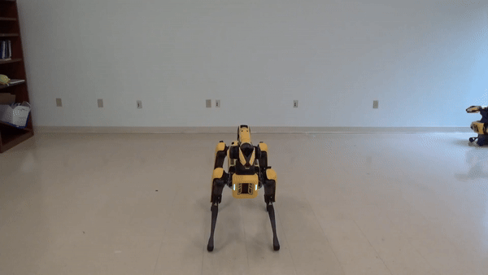</a> | <a href="assets/media/rt2m/FLB.gif">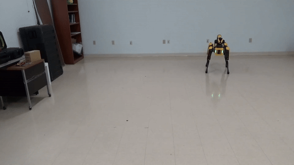</a> | <a href="assets/media/rt2m/CC.gif">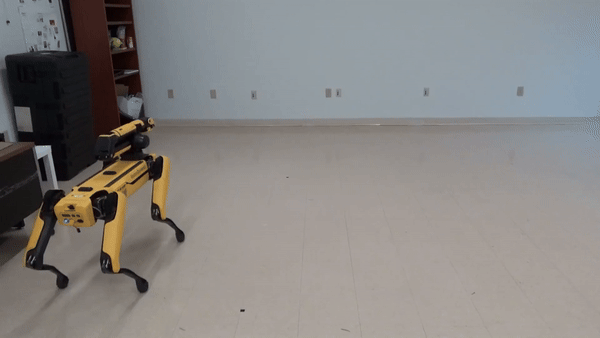</a> |

### Text to human motion

| Run on a treadmill | Walk forward and sit | Perform repeated cartwheels |
| :---: | :---: | :---: |
| <a href="assets/media/ht2m/treadmil.gif">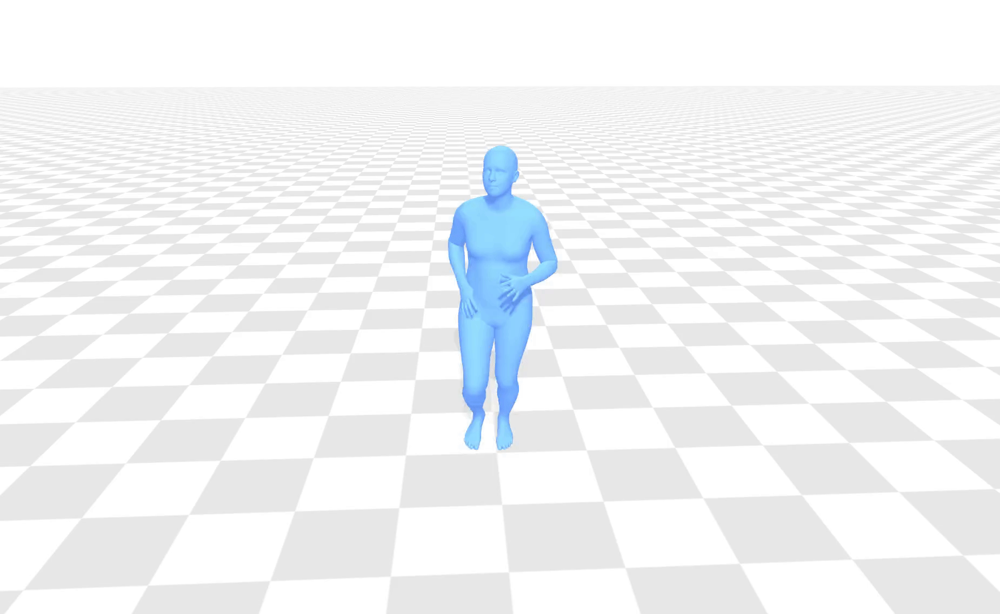</a> | <a href="assets/media/ht2m/wfs.gif">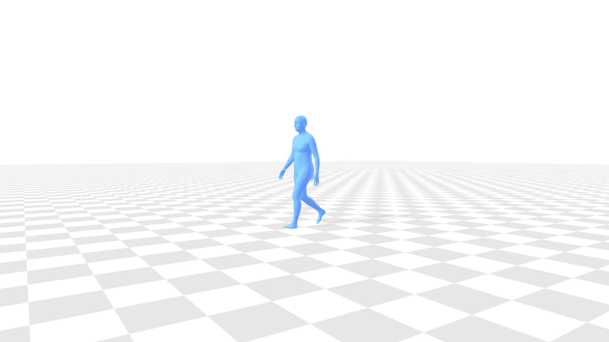</a> | <a href="assets/media/ht2m/multiple_cartwheel2.gif">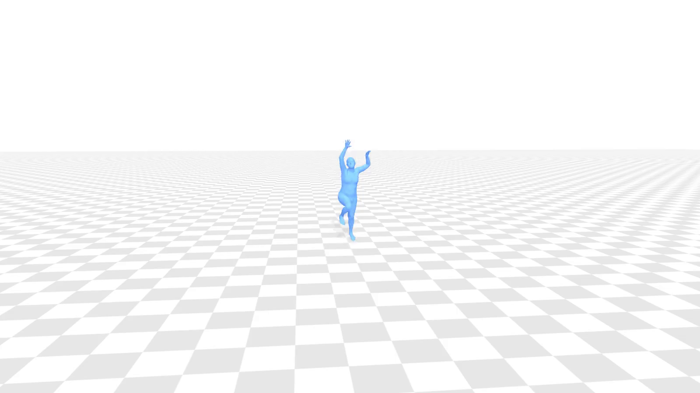</a> |

### Questions answered with human motion

| How can someone increase leg strength? | How does someone practice gymnastics? | Show a move from a golf game |
| :---: | :---: | :---: |
| <a href="assets/media/ht2m/leg_strength.gif">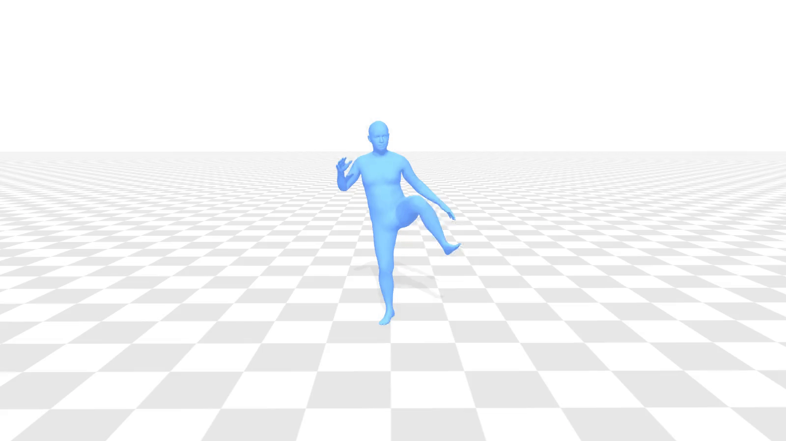</a> | <a href="assets/media/ht2m/gymnastics_class.gif">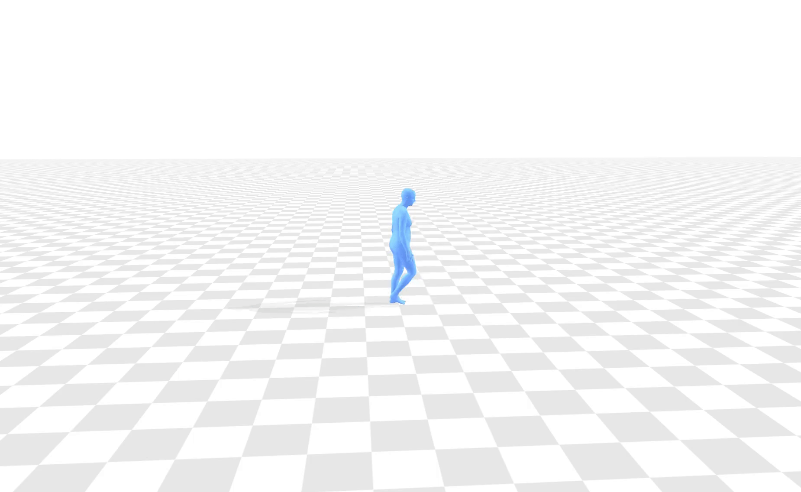</a> | <a href="assets/media/ht2m/golf_game.gif">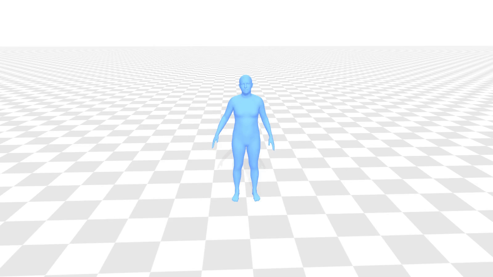</a> |

### Robot goal reaching

Different generated trajectories approach the highlighted goal region.

| Goal example 1 | Goal example 2 | Goal example 3 |
| :---: | :---: | :---: |
| <a href="assets/media/goal_reaching/goal1_1.png">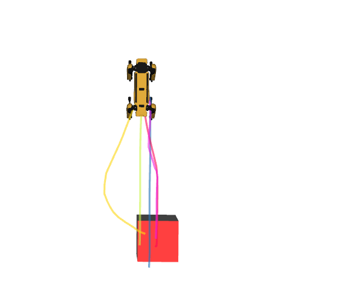</a> | <a href="assets/media/goal_reaching/goal2_1.png">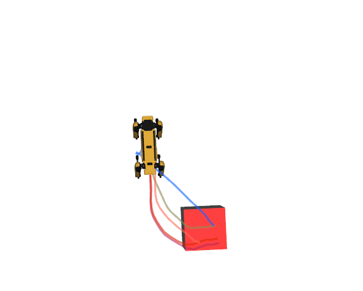</a> | <a href="assets/media/goal_reaching/goal3_1.png">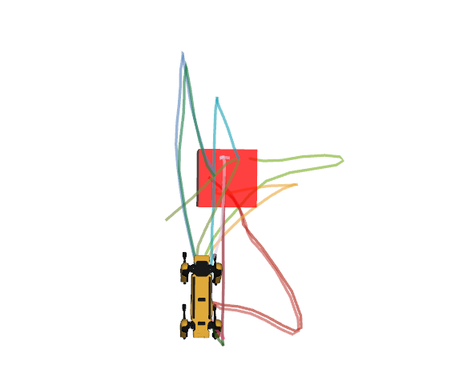</a> |

### Human motion captioning

| Marching forward with arms swinging | Dancing a waltz | Performing warm-up stretches |
| :---: | :---: | :---: |
| <a href="assets/media/hmc/march.gif">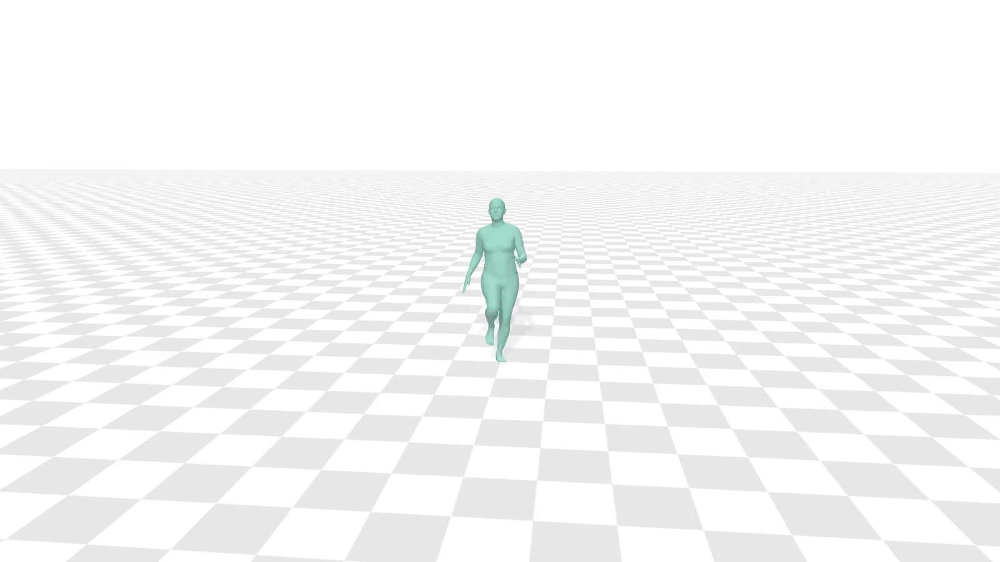</a> | <a href="assets/media/hmc/waltz.gif">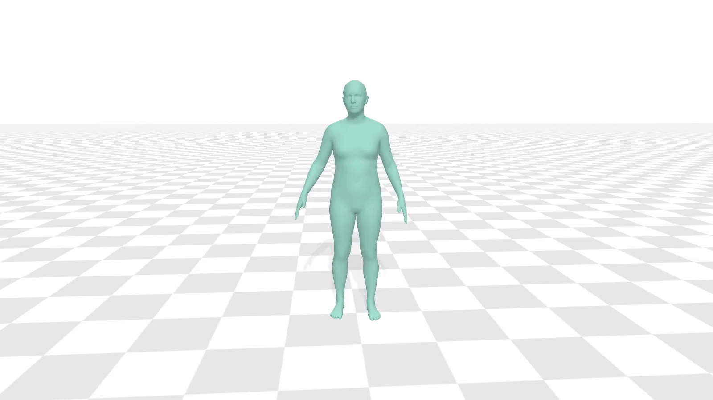</a> | <a href="assets/media/hmc/warmup.gif">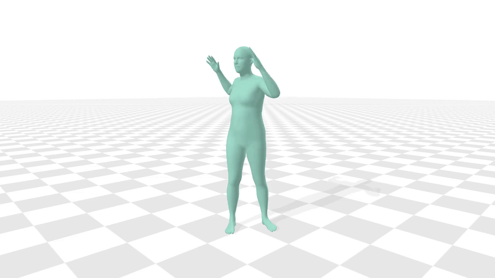</a> |

## Install

Use a fresh Python environment. Install a PyTorch build appropriate for your CUDA version, or a CPU build for the tests, before installing this package.

```bash
python -m venv .venv
source .venv/bin/activate
python -m pip install --upgrade pip
python -m pip install -e '.[test]'
motionglot --help
python -m pytest -q
```

Transformers 4.44.2 and Accelerate 0.33.0 are pinned. Local validation used Python 3.8.20, PyTorch 1.13.1 and NumPy 1.23.5 on CPU. The GitHub Actions workflow also defines a Python 3.10 / PyTorch 2.4.1 CPU job. `python -m motionglot` is equivalent to the `motionglot` command. Run commands from this repository root.

## Data

Obtain and preprocess [HumanML3D](https://github.com/EricGuo5513/HumanML3D) through its upstream instructions and applicable dataset terms. The directory must contain `new_joint_vecs/`, `texts/`, `train.txt`, `val.txt`, and `test.txt`. Use the mean and standard deviation **associated with the human VQ checkpoint**, not new statistics calculated from evaluation data.

Robot input consists of `.pt` tensors of shape `[frames,3]`. The recovered files use names such as `W_8_9.pt`, `M_W_8_9.pt`, and `S_10_W_8_9.pt`: recording, segment, and optional augmentation prefixes. Recording annotation files such as `W_8.txt` contain one caption per segment. The command reconstructs mirrored captions and paraphrases using the original tables. `--robot-caption-mode per-motion` instead accepts one `.txt` file per tensor. See [`docs/data.md`](docs/data.md) for schemas, axes, splitting and custom datasets.

The QUES-CAP inputs are question text files and the **original** ordered `file_names.txt` mapping. They are read without calling a language-model API.

```bash
motionglot prepare-data \
  --human-root data/HumanML3D \
  --robot-root data/QUAD-LOCO/robot_trajectories \
  --robot-captions data/QUAD-LOCO/new_annotation_cleaned \
  --questions data/QUES-CAP/gpt_4_prompts2_clean.txt \
  --file-names data/HumanML3D/file_names.txt \
  --output data/manifest.jsonl
```

This preserves official HumanML3D splits and groups robot recordings with all their augmented variants. The resulting manifest contains explicit train, validation and test splits. Custom manifests can be written directly using the documented schema.

## Train motion tokenizers

Human and robot VQ-VAEs use 512 and 128 codes respectively, with code dimension 512 and temporal downsampling by four. Existing checkpoints can be used instead of retraining. Training writes `latest.pth` with architecture metadata; human training also writes its normalization statistics. Training currently uses one device per VQ-VAE.

```bash
motionglot train-vq \
  --manifest data/manifest.jsonl --config configs/human_vq.json \
  --normalization data/human_meta --output checkpoints/human_vq \
  --window 64 --batch-size 128 --lr 2e-4 --steps 200000

motionglot train-vq \
  --manifest data/manifest.jsonl --config configs/robot_vq.json \
  --output checkpoints/robot_vq --window 192 --batch-size 512 \
  --lr 1e-5 --steps 200000
```

The robot loss combines reconstruction, commitment and cumulative-trajectory losses from the recovered trainer. The human loss uses smooth L1 reconstruction, commitment and joint-position regularization. These commands save the latest model; selecting the paper's best FID checkpoint requires the separate evaluator and its artifacts.

## Merge vocabularies and prepare the six tasks

[`assets/tokenizer/`](assets/tokenizer/) contains the recovered tokenizer: 50,257 GPT-2 tokens, 512 human codes, 128 robot codes, 784 goal cells, and 13 task/gait markers, for **51,694 tokens**. Do not change its ordering when using recovered GPT weights.

To rebuild the same vocabulary from GPT-2:

```bash
motionglot build-vocab --base openai-community/gpt2 --output outputs/tokenizer
```

Prepare instruction data using either the included tokenizer or the rebuilt one:

```bash
motionglot build-corpus \
  --manifest data/manifest.jsonl --tokenizer assets/tokenizer \
  --human-vq checkpoints/human_vq/latest.pth \
  --robot-vq checkpoints/robot_vq/latest.pth \
  --normalization checkpoints/human_vq/normalization.npz \
  --sentiment-augmentation --max-length 256 --output data/instructions
```

The corpus contains `train.jsonl`, `valid.jsonl`, `test.jsonl`, and `metadata.json` with counts and a tokenizer fingerprint. Captioning uses captions; question-to-human uses questions. Both human generation tasks share `<toh>`, as in the research code. Robot sentiment augmentation adds gallop examples to training only. Trajectories whose reconstructed endpoints fall outside the goal grid are counted and excluded from the goal task. Instructions that exceed the context limit raise an error instead of cutting off motion or end tokens.

## Train GPT-2

```bash
motionglot train-gpt \
  --corpus data/instructions --tokenizer assets/tokenizer \
  --output checkpoints/motionglot --steps 20000 \
  --batch-size 16 --gradient-accumulation 4 --lr 5e-4
```

This initializes from pretrained GPT-2 and resizes its embeddings. Use `--from-scratch` to initialize random weights explicitly, or `--resume checkpoints/motionglot/checkpoint-10000` to resume a run. Logging is local; no account is required. For eight GPUs, use:

```bash
accelerate launch --multi_gpu --num_processes 8 -m motionglot train-gpt \
  --corpus data/instructions --tokenizer assets/tokenizer \
  --output checkpoints/motionglot --steps 20000 \
  --batch-size 16 --gradient-accumulation 4 --lr 5e-4
```

The next-token objective covers the complete instruction, with padding labels masked using the attention mask. The test corpus is held out from training and validation.

## Inference

[`examples/inference.sh`](examples/inference.sh) gives commands for all six tasks. A trained GPT directory includes its tokenizer. For an original research checkpoint that lacks tokenizer files, additionally pass `--tokenizer assets/tokenizer`.

```bash
motionglot generate --task text-to-human \
  --model checkpoints/motionglot \
  --human-vq checkpoints/human_vq/latest.pth \
  --normalization checkpoints/human_vq/normalization.npz \
  --text 'A person walks forward.' --output outputs/human

motionglot generate --task text-to-robot \
  --model checkpoints/motionglot --robot-vq checkpoints/robot_vq/latest.pth \
  --text 'A robot walks forward and turns right.' --sample --output outputs/robot

motionglot generate --task goal-to-robot \
  --model checkpoints/motionglot --robot-vq checkpoints/robot_vq/latest.pth \
  --goal 1.0 2.0 --sample --output outputs/goal
```

Motion outputs are `.npy` arrays and a `.json` metadata file; captions are written to `.json`. Human arrays are denormalized 263-dimensional HumanML3D features. Robot arrays use the tokenizer's planar increment/angular-increment coordinates; gait is separate metadata. Output tokens are constrained to the task's vocabulary. `terminated: false` reports that the model reached the generation limit before its task end token. These commands generate trajectories; hardware execution requires the separate controller described in the paper.

## Source and license

Source code is released under Apache-2.0. The VQ-VAE is adapted from [T2M-GPT](https://github.com/Mael-zys/T2M-GPT); its license and attribution are preserved in [`LICENSE`](LICENSE), [`NOTICE`](NOTICE), and [`licenses/`](licenses/). Data, body models, evaluator weights and trained checkpoints are not covered by the source-code license. See [`THIRD_PARTY_NOTICES.md`](THIRD_PARTY_NOTICES.md).

Please cite the paper when using this work; [`CITATION.cff`](CITATION.cff) provides citation metadata.

```bibtex
@article{harithas2024motionglot,
  title={MotionGlot: A Multi-Embodied Motion Generation Model},
  author={Harithas, Sudarshan and Sridhar, Srinath},
  journal={arXiv preprint arXiv:2410.16623},
  year={2024}
}
```
